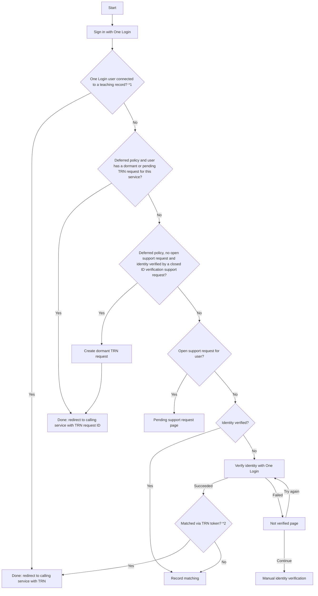
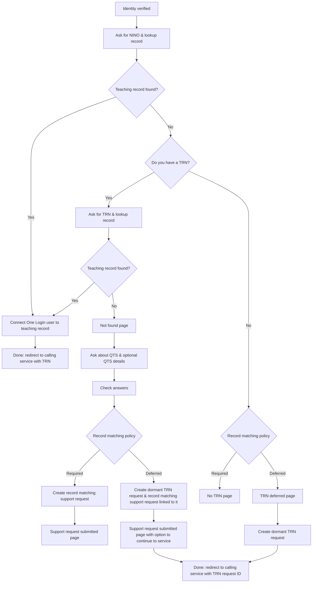
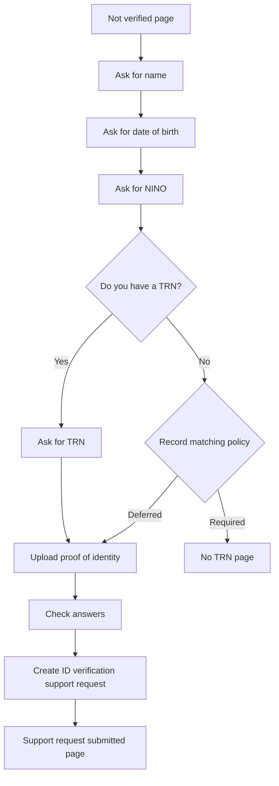
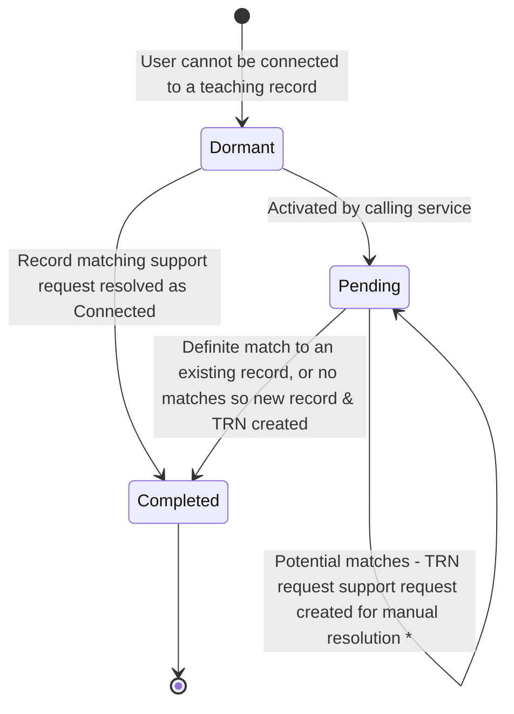

# High level flow of signing in to a service that requires authorisation to the teaching record via GOV.UK One Login

The `Start` represents the point at which a user visits a service domain for example [Access your teaching qualifications](https://access-your-teaching-qualifications.education.gov.uk/qualifications/start).
They would be re-directed to [GOV.UK One Login](https://www.sign-in.service.gov.uk/) to sign in. The Teaching Record System will handle the OAuth flow between GOV.UK One Login and the calling service. As part of this flow it will provide matching and authorisation against the teaching record, only returning to the calling service when this authorisation succeeded. Details of both the One Login user and the teaching record will be passed to the calling service, where it can apply any service-specific rules, if required.

The journey is orchestrated by `SignInJourneyCoordinator` in `TeachingRecordSystem.AuthorizeAccess`.

## Record matching policies

Each calling service (application user) has a `RecordMatchingPolicy` that controls what happens when a user cannot be connected to a teaching record:

- **`Required`** - the user must be connected to a teaching record before they are returned to the calling service. The calling service always receives a `trn` claim.
- **`Deferred`** - for services where users may not yet have a TRN but will need one later (e.g. when they are accepted on a course). If the user cannot be connected to a teaching record, a [dormant TRN request](#dormant-trn-requests) is created on their behalf and they are returned to the calling service with the ID of that TRN request (the `_ta_trid` claim in the access token) instead of a TRN.

## Signing in

\*1 On sign in, a One Login user that is not yet connected to a teaching record is automatically verified and connected if they have a single identity-verified TRN request that has been completed (see [dormant TRN requests](#dormant-trn-requests)).

\*2 If the calling service passed a TRN token (e.g. from an Access your teaching qualifications link), the verified One Login identity is checked against the record the token was issued for.

Identity verification is only requested from One Login if the user hasn't previously been verified, either by One Login or by a support user.

## Record matching

Once the user's identity is verified, they are asked for details to find their teaching record.
Matching uses the verified name(s) and date(s) of birth along with the National Insurance number and TRN the user provides.

When a record matching support request is resolved by a support user:

- **Connected** - the One Login user is connected to the chosen teaching record. If the support request is linked to a TRN request, that TRN request is resolved with the chosen record (see [dormant TRN requests](#dormant-trn-requests)); otherwise the user is sent a 'record matched' email.
- **No matches** - if the linked TRN request has already been activated (i.e. is `Pending`) TRS attempts to resolve it; if it's still `Dormant` it is left until it's activated. Services with the `Required` policy send the user a 'record not found' email.
- **Not connecting** - as above for the linked TRN request. Services with the `Deferred` policy send the user a 'not connected' email.

## Manual identity verification

If the user cannot (or chooses not to) verify their identity with One Login, they can provide their details and proof of identity to be checked by a support user.

The user is not returned to the calling service at this point. When the ID verification support request is resolved by a support user:

- **Not verified** - the user is sent a 'not verified' email.
- **Verified and connected** - the One Login user is verified and connected to the chosen teaching record, and the user is sent a 'record matched' email. The next time they sign in they are returned to the calling service with their TRN.
- **Verified only** - the One Login user is verified but not connected to a teaching record. The user is sent a 'not connected' email (`Deferred` policy services, where potential matches were found) or a 'record not found' email (where no matches were found). The next time they sign in:
  - for `Deferred` policy services, a dormant TRN request is created automatically and they are returned to the calling service with the TRN request ID;
  - for `Required` policy services, they go through [record matching](#record-matching).

While a support request is open, signing in shows the user a holding page with the support request reference, unless they are already connected to a teaching record or (for `Deferred` policy services) already have a TRN request for the service.

## Dormant TRN requests

For services with the `Deferred` policy, a TRN request is created in the `Dormant` state when the user cannot be connected to a teaching record.
It is created using the user's verified name and date of birth, their One Login email address and the National Insurance number they provided (if any), and is marked as identity verified for the One Login user.
A dormant TRN request does not attempt to find a matching record or allocate a TRN until it is activated by the calling service.

The calling service receives the TRN request ID in the access token and can use that access token with the API to:

- `GET /v3/trn-request` - get the status of the TRN request (including dormant requests);
- `PUT /v3/trn-request/activate` - activate the TRN request, e.g. once the user has been accepted on a course.

If the user signs in again while their TRN request for the service is still `Dormant` or `Pending`, they are returned to the calling service with the same TRN request ID; a new TRN request is not created.

\* When the TRN request is activated, if there is an open support request linked to it (e.g. the record matching support request created from the 'Check answers' page) resolution is left to that support request. Otherwise TRS tries to resolve the request immediately; if there are potential duplicates a TRN request support request is created and the request remains `Pending` until a support user resolves it.

When the TRN request is resolved to a teaching record:

- the One Login user is connected to that teaching record (if not already connected);
- the calling service is sent a `trn_request.completed` webhook notification containing the TRN;
- on subsequent sign ins, the user is returned to the calling service with their TRN.

Some services require further manual checks when a TRN request is resolved to an existing record; in that case the request remains `Pending` with a 'manual checks needed' support request until those checks are completed.
